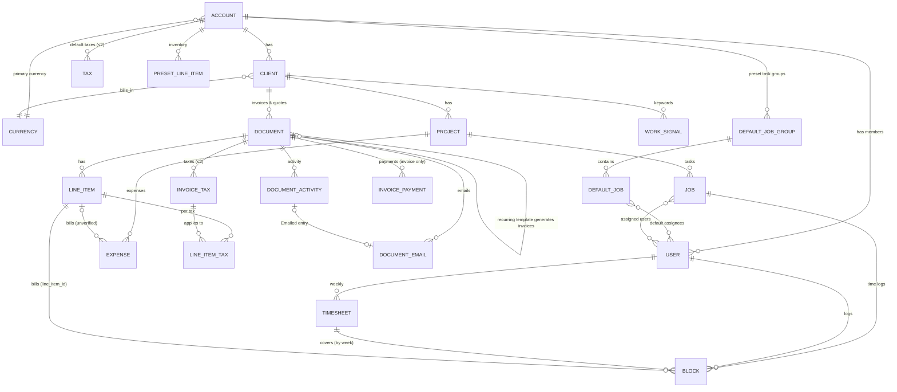

# 08 — Data model & API

Paydirt's entities, attributes, relationships, enumerations and derived values. Also covers the
public REST API (v1) and the internal JSON endpoints the SPA uses.

Sources: Backbone models/collections in `app.js` (`Paydirt.Models.*`, `Paydirt.Collections.*`),
`Paydirt.Routes`, ajax calls, HAML templates, form field names in server pages, the bootstrap
payload `data_all.json` (`GET /data/all`), and the API docs (`pages/documentation__api__*.html`).
Attribute lists combine all of these. *(from code)* marks behaviour that was not seen in the UI.
Internal names differ from UI labels. Mapping: **Job = Task**, **Block = Time log / log entry**,
**DefaultJob(Group) = Preset Task (Group)**, **PresetLineItem = Inventory item**,
**WorkSignal = Keyword**, **Document = Invoice or Quote**.

---

## 1. Entity overview

| Entity (internal) | UI name | Owner | Persisted at | Notes |
|---|---|---|---|---|
| Account | Account / business | — | `/settings/account*` | Tenant. Holds plan, defaults, currency, integrations |
| User | Team member | Account | `/users`, `/settings` | Role + permission flags |
| Currency | Currency | global | reference data | 53 rows |
| Client | Client | Account | `/clients` | Has currency, locale, rate, invoice prefix |
| Project | Project | Client | `/clients/:cid/projects` | Groups tasks & expenses; optional integration link |
| Job | Task | Project | `/jobs` | Price type + price; estimate; assignment |
| Expense | Expense | Project | `/expenses` | Quantity × unit value |
| Block | Time log | User + Job | `/time` | Duration-only or start/end; billable; billed via line item |
| RunningBlock | Running timer | User | `/tracker/*`, `/time/running` | A Block with `running=true` |
| Timesheet | Timesheet | User | `/timesheets` | Weekly; approval workflow |
| Document → Invoice / Quote | Invoice, Quote, Recurring invoice | Client | `/invoices`, `/quotes`, `/recurring_invoices` | STI by `type` |
| LineItem | Line item | Document | nested (`line_items_attributes`) | `TimeLineItem` quantity in seconds |
| InvoiceTax | Document tax | Document | nested (`taxes_attributes`) | Max 2 per document (tax0, tax1) |
| LineItemTax | Tax applies-to flag | LineItem × InvoiceTax | nested | `applies` boolean |
| Tax | Default tax | Account (or taxable) | `/taxes` | Up to 2 defaults copied onto new documents |
| InvoicePayment | Payment | Invoice | `/invoices/:id/invoice_payments` | |
| InvoiceEmail (DocumentEmail) | Sent email | Document | `/document_emails` | Typed email record |
| DocumentActivity | Activity entry / note | Document | `/documents/:id/activities` | Audit log + custom notes |
| PresetLineItem | Inventory item | Account | `/preset_line_items` | Description + unit price |
| DefaultJobGroup | Preset Task Group | Account | `/default_job_groups` | Template project |
| DefaultJob | Preset Task | DefaultJobGroup | `/default_job_groups/:gid/default_jobs` | Template task + default assignees |
| WorkSignal | Keyword | Client | `/work_signals` | Used by Chrome extension to suggest client |
| Report models | (filters) | — | client-side | `Report`, `TimeReport`, `BlockReport`, `DocumentReport` hold query state |

---

## 2. ER diagram



`DOCUMENT` stands for the STI table with `type ∈ {ClientInvoice, RecurringInvoice, FreeformInvoice, ClientQuote, FreeformQuote}`.

---

## 3. Entities and attributes

Types: `int`, `str`, `text`, `bool`, `date` (YYYY-MM-DD), `datetime` (ISO 8601), `money`
(decimal string, e.g. `"85.0"`, wrapped client-side in `Money`), `secs` (integer seconds).

### 3.1 Account

| Attribute | Type | Notes / default |
|---|---|---|
| id, unique_id | int, str (hex) | `unique_id` used for analytics |
| business_name | str | Business Details › Business name |
| billing_contact_name | str | Business Details › Contact name; email var `our_contact_name` |
| billing_email_address | str | Business Details › Billing email (SPF check `POST /settings/check_spf`) |
| billing_address | text | Business Details › Business address |
| currency_id | int → Currency | "Primary currency"; default currency for new clients |
| default_price_type, default_price | int (price type), money | "Default pricing" for new tasks |
| first_day_of_week | int 0–6 | 0 = Sunday … 6 = Saturday (captured: 1) |
| payment_period | int days | "Payment terms" default **7** — sets new invoice due date offset |
| payment_details | text | "Invoice footer" (bank details etc.) |
| quote_footer | text | |
| logo / logo_path | file / URL | max 769×300, resized |
| use_client_shortnames | bool | Invoice numbers prefixed with client shortname |
| line_item_creation_options | object | see below |
| weekly_summary_email, forgotten_blocks_email, invoice_overdue_notification_emails | bool | Email prefs (timer left running > 12h) |
| timesheet_approval | bool | Enables timesheet workflow |
| allowed_clients | int / null | Plan limit on active clients (null = unlimited) |
| features | `{paypal, stripe, extra_users, assignment}` bools | Plan feature flags |
| paypal_feature, paypal_enabled | bool | Feature available / configured |
| stripe_feature, stripe_connected, stripe_enabled | bool | |
| trello_connected, basecamp_connected, redbooth_connected | bool | Integrations |

`line_item_creation_options` (Settings › Line Item Creation):

| Key | Type | Options / default (captured) |
|---|---|---|
| line_item_rounding_type | int | 0 No rounding · 1 Round to nearest · 2 Round up to (0) |
| line_item_rounding_value | int minutes | 5 |
| include_total_hours_in_invoice_description | bool | false |
| include_project_names_in_invoice_description | bool | false |
| group_line_items_by_job | bool | false |
| group_line_items_by_date | int / null | null = no date grouping; 0 day · 1 week · 2 month |
| include_project_names_in_line_item_descriptions | bool | true |
| include_job_names_in_line_item_descriptions | bool | true |
| include_block_descriptions_in_line_item_descriptions | bool | true |

### 3.2 User

| Attribute | Type | Notes |
|---|---|---|
| id, name, email | int, str, str | API exposes only these three |
| password / password_confirmation | — | Settings › Password |
| time_zone | str (Rails zone name) | e.g. "Pacific Time (US & Canada)" |
| avatar / avatar_url / medium_avatar_url | file / URL | < 200KB square |
| hourly_rate | money | Used by price type "User hourly rate"; `update_blocks` flag on change offers to re-rate existing logs *(unverified)* |
| role | enum | owner (account creator) · admin · employee · contractor (invite form) |
| permissions | object of 5 bools | manage_account, manage_invoices, view_financial_information, view_all_time_logged, log_time_without_assignment |
| submits_timesheets | bool | Required to submit weekly timesheets |
| archived | bool | Archived users excluded from `current()` |
| installed_extension | bool | Chrome extension installed (enables Keywords tab) |
| dismissed_notices | array | One-off notices the user closed |
| api_key | str | Shown on Settings › Password ("Your API Key") |

### 3.3 Client

| Attribute | Type | Default / notes |
|---|---|---|
| id, created_at, updated_at | | |
| business_name | str, required | sort key (case-insensitive) |
| billing_contact_name | str | "Contact name — Who do you address your invoices to?" |
| billing_email_address | str | comma-separated list allowed |
| billing_address | text | "Address & details" (tax IDs etc.) |
| currency_id | int | account currency. Changing it changes the currency of all the client's invoices, tasks, expenses and time logs |
| hourly_rate | money | 0. Basis of price type "Client rate" |
| locale | str | `"en"` — document language |
| shortname | str | Invoice prefix ("Invoice numbering": No prefix / New prefix) |
| invoicing_threshold | money | **1000** — flagged "ready to invoice" when unbilled ≥ threshold |
| color | hex | random from 10-colour palette |
| monogram | str (≤2 chars) | badge text; `badgeType()` = "logo" if `logo_path` else "monogram" |
| logo / logo_path | file / URL | |
| active | bool | false = archived |
| destroyed | bool | soft-delete flag in pushes |
| amount_unbilled, amount_owing, amount_overdue, amount_quoted, amount_invoiced | money (server-computed) | Client list columns / summary bar |
| projects[], work_signals[] | nested | |

### 3.4 Project

| Attribute | Type | Default / notes |
|---|---|---|
| id, client_id, name, created_at | | API: id, client_id, name |
| completed | bool | false |
| hourly_rate | money | 0. Basis of "Project rate" |
| estimate | secs / null | budget hours |
| duration | secs | total logged |
| completed_jobs_count | int | "Show N completed tasks" |
| jobs_unbilled_value, expenses_unbilled_value | money | |
| default_price_type | int | 3 (Client rate). Used for imported tasks |
| import_jobs, accept_completeness | bool | Integration sync options (import new cards/todos; mirror completion) |
| trello_board_id / basecamp_project_id + basecamp_account_id + basecamp_version (`bc3`) / redbooth_project_id | ids | Linked external project |
| jobs[], expenses[] | nested | |

### 3.5 Job (Task)

| Attribute | Type | Default / notes |
|---|---|---|
| id, project_id, client_id, name | | |
| price_type | int enum | **3** (Client rate). See §4.1 |
| price | money | 0. Meaning depends on price type (hourly rate or fixed amount) |
| estimate | secs | optional "time estimate" |
| completed | bool | false. Completed tasks sort last |
| position | str/int | manual order (drag) |
| assigned_user_ids | int[] | Task assignment (plan feature `assignment`) |
| duration | secs | total logged |
| unbilled_duration | secs | |
| unbilled_hourly_value | money | value of unbilled hourly time |
| unbilled_fixed_value | money | remaining fixed price not yet billed |
| unbilled_value | money | total unbilled |
| amount_to_invoice | money | UI-only input for fixed-price billing in the invoice builder |
| estimate_progress | number | % of estimate used |
| trello_card_id / basecamp_todo_id / redbooth_task_id | ids | |

### 3.6 Expense

| Attribute | Type | Default / notes |
|---|---|---|
| id, project_id, name | | |
| quantity | float | **1** |
| value | money | unit cost |
| total | money | derived `quantity × value` |
| billed / line_item_id | | *(unverified, by analogy with blocks)* |

### 3.7 Block (Time log)

| Attribute | Type | Notes |
|---|---|---|
| id, created_at, updated_at | | |
| user_id | int | default current user |
| job_id, project_id, client_id | int | job required by API |
| job_name, project_name, client_business_name, client_color, client_monogram | denormalised | for list rendering |
| duration_only | bool | true = "duration" entry with a date; false = start/end times |
| start_date, end_date | date | (end_date can differ for overnight) |
| start_time, end_time | str `h:mma` | e.g. "9:00am"; also `start_time_with_seconds`, `formatted_start_time/end_time` |
| duration | secs | derived when not duration_only: `end − start − paused_duration` (≥ 0) |
| paused_duration | secs | total paused time |
| running | bool | timer state |
| paused_at, pause_time, pause_time_with_seconds, pause_date | | pause bookkeeping; `isPaused()` = pause_time_with_seconds present |
| current_duration, current_paused_duration | secs | live values for running timers |
| description | text (markdown) | |
| billable | bool | from task/user billability (`GET /time/get_billability`) |
| hourly_rate | money | rate at time of logging |
| value | money | `hourly_rate × duration/3600` |
| currency_id | int | client currency |
| billed | bool | `line_item_id != null || external_billing_reference != null` |
| line_item_id | int | set when included in an invoice |
| external_billing_reference | str | "billed elsewhere" marker (bulk add/remove) |
| suggested_client_id, project_integration_id | | tracker suggestions (extension) |
| destroyed | bool | in pushes |

API representation differs: `date` (duration-only), `started_at`/`ended_at` (datetimes), `duration`, `value`, `billable`, `billed`.

### 3.8 Timesheet

| Attribute | Type | Notes |
|---|---|---|
| id, user_id | | |
| week_number | int/str | URL key `/timesheets/:week_number` |
| start_date, end_date | date | week bounds (account week start) |
| status | int | 0 unsubmitted · 1 submitted · 2 approved · 3 declined |
| total_duration | secs | |
| daily_totals | array | per-day totals |

Transitions: `canBeSubmitted` = unsubmitted/declined → submitted (`PUT /timesheets/:week`); `canBeApproved` = submitted/declined → approved (`PUT …/approve`); `canBeDeclined` = submitted/approved → declined (`PUT …/decline`). Users are emailed a reminder at week end.

### 3.9 Document (Invoice / Quote) — common

| Attribute | Type | Notes |
|---|---|---|
| id, type | | STI: ClientInvoice · RecurringInvoice · FreeformInvoice · ClientQuote · FreeformQuote |
| client_id | int | |
| number | int | displayed via `formattedNumber()` |
| currency_id | int / null | falls back to client currency |
| locale | str / null | falls back to client locale |
| issued_at | date | |
| description | text | "Description" block on the document |
| footer | text | from account `payment_details` / `quote_footer` |
| account_business_name, account_contact_name, account_address | snapshot | "From" block (editable per document) |
| client_business_name, client_contact_name, client_address | snapshot | "To" block |
| subtotal, total | money | server values; recomputed client-side |
| sent | bool | marked sent (by email or manually) |
| private_id | str | public URL token `/…/view/:private_id` |
| created_at, updated_at | | |
| line_items[], taxes[], emails[], activities[] | nested | |

**Invoice-specific:** `due_at` (date), `due_at_offset` (days, derived: `due_at − issued_at`; editing either side recomputes the other), `amount_paid`, `paid_at`, `paypal_payment_enabled`, `stripe_payment_enabled`, `quote_id` (created from quote), `payments[]`.

**RecurringInvoice-specific:** `every` (0 week · 1 month · 2 year), `interval` (≥1, default 1), `on` (weekday 0–6 for weekly; day 1–31 for monthly, 31 = "last day"; yearly uses start date), `recurring_start_date` (default today), `enabled` (bool), `upcoming_recurring_dates[]`. Defaults: every month, interval 1, on 1. Number shown as `recurring-NNN`.

**Quote-specific:** `accepted_at`, `declined_at`.

### 3.10 LineItem

| Attribute | Type | Notes |
|---|---|---|
| id, type | | `TimeLineItem` for time-based items; otherwise a plain item (other type names not observed) |
| description | text (markdown) | |
| quantity | number | **seconds** for TimeLineItem (shown/entered as `H:MM` or decimal hours); otherwise a decimal |
| rate | money | unit price (per hour for time) |
| subtotal | money | derived (§6) |
| position | str | order (drag sortable) |
| line_item_taxes[] | nested | one per document tax, `applies` default true |
| _destroy | flag | nested-attributes delete |

### 3.11 Taxes

| Entity | Attributes | Notes |
|---|---|---|
| Tax (account default) | id, name (default "Tax"), percentage (default 10) | "You can have up to 2 default taxes"; applied to new quotes and invoices |
| InvoiceTax | id, name, percentage, _destroy | per document; at most 2 (`tax0`, `tax1`) |
| LineItemTax | id, line_item_id, tax_id / tax_cid, applies (bool, default true), _destroy | per-line toggle (checkbox `includes_tax`) |

### 3.12 InvoicePayment

| Attribute | Type | Notes |
|---|---|---|
| id, invoice_id | | |
| received_at | date | |
| amount | money | |
| description | text | optional note, shown in quotes |
| thankyou_invoice_email | datetime / null | when a thank-you email was sent ("thanked on …"); else "Send a thank-you email" link |

### 3.13 DocumentEmail (InvoiceEmail)

| Attribute | Notes |
|---|---|
| type | NewQuoteEmail · NewInvoiceEmail · ReminderInvoiceEmail · ThankyouInvoiceEmail |
| to_email_address, cc_email_address | |
| subject, body | interpolated with `{{ variable }}` placeholders (§4.6) |
| failed | bool → activity "Failed to email … to …" |
| document_activity_id | links to its activity entry |

### 3.14 DocumentActivity

| Attribute | Notes |
|---|---|
| id, date, type, amount, description | `type` enum §4.5. `Custom` = user note ("Add a note"); deletable (×, confirm "Are you sure you want to remove this activity?") |

### 3.15 Catalogue entities

| Entity | Attributes |
|---|---|
| PresetLineItem (Inventory) | id, description (markdown), rate |
| DefaultJobGroup (Preset Task Group) | id, name, created_at, default_jobs[] |
| DefaultJob (Preset Task) | id, default_job_group_id, name, price (0), price_type (3), assigned_user_ids[], created_at. Assign/unassign a user per client set (`client_ids`) |
| WorkSignal (Keyword) | id, client_id, text |
| Currency | id, code, sign, name, created_at, updated_at |

### 3.16 Tracker job (denormalised list)

`/data/all` › `tracker_jobs[]`: id, project_id, client_id, project_name, client_business_name,
client_color, client_monogram, name, basecamp_todo_id, trello_card_id, redbooth_task_id,
assigned_user_ids. That is the list of tasks the current user can track against.

---

## 4. Enumerations

### 4.1 Price type (Job, DefaultJob, Account default, Project default)

| Value | Code predicate | UI label (picker title / pill) | Billing rule |
|---|---|---|---|
| 0 | `perHour` | "Custom hourly rate" / "$X per hour" | billable at `price` per hour |
| 1 | `fixedPrice` | "Fixed price" / "$X fixed price" | fixed `price` amount; time logged defaults to not billable |
| 2 | `perUser` | "User hourly rate" | billable at each user's `hourly_rate` |
| 3 | `clientHourlyRate` (default) | "Client rate ($85 /hr)" / "Client rate → $85 per hour" | billable at client `hourly_rate` |
| 4 | `notBillable` | "Not billable" | no value |
| 5 | `projectHourlyRate` | "Project rate ($0 /hr)" | billable at project `hourly_rate` |

The public API documents only 0, 1 and 2.

### 4.2 Statuses & states

| Entity | States | Derivation *(from code)* |
|---|---|---|
| Invoice `state()` | draft · sent · overdue · paid · recurring | recurring if type RecurringInvoice; **overdue** if sent ∧ due_at < today ∧ ¬paid; else draft if ¬sent; sent if sent ∧ ¬paid; paid if sent ∧ paid |
| Invoice `paid()` | bool | `paid_at` set **or** (has payments ∧ amountOwing ≤ 0) |
| Quote `state()` | draft · sent · accepted · declined | declined_at → declined; accepted_at → accepted; sent → sent; else draft. `current()` = not accepted and not declined |
| Quote manual state | draft/sent/accepted/declined | `PUT /quotes/:id/mark_{state}` from the "Quote Status" dropdown |
| Recurring invoice | enabled / disabled | `PUT …/enable`, `…/disable` |
| Timesheet | 0 unsubmitted · 1 submitted · 2 approved · 3 declined | §3.8 |
| Block | running / paused / stopped; billable / not; billed / unbilled | |
| Job / Project | active / completed | |
| Client | active (current) / archived | |
| User | active / archived | |

Invoice list filter `type`: current ("Unpaid Invoices"), overdue, paid, all; `by`: issued_at, due_at, paid_at.
Quote list filter `type`: current, accepted, declined, all; `by`: issued_at, accepted_at, declined_at.

### 4.3 Roles & permissions

Roles: **Owner**, **Admin**, **Employee** (default in invite form), **Contractor**. Each user also has the 5 permission flags (§3.2), which can be edited per user on the team page. Role presets probably set default flags *(unverified)*. API access requires full permissions.

### 4.4 Other enums

| Enum | Values |
|---|---|
| Report range | week · month · quarter · year · custom · all-time (time list default `week`; document lists default `all-time` for "current") |
| TimeReport target | team (default) |
| Recurrence unit (`Paydirt.Enums.IntervalTimeUnit`) | WEEK 0 · MONTH 1 · YEAR 2 |
| Line item rounding | 0 none · 1 nearest · 2 up |
| Date grouping | 0 day · 1 week · 2 month |
| Day of week | 0 Sunday … 6 Saturday |
| Badge type | logo · monogram |
| Email type (compose URL `type`) | quote · invoice · reminder *(unverified name)* · thankyou |
| Integration service | Trello (board/card) · Basecamp 2/3 (project/todo) · Redbooth (project/task) |
| Plans (as seen) | Starter ($8/mo, 1 user, 3 active clients) · Hustler ($16, 1 user, unlimited clients, online payments) · Co-op ($29, 3 users) · Small Team ($49, 6) · Large Team ($79, 10) · Agency ($149, 20) · Enterprise ($249, 40 + $5/user). Annual ≈ 10× monthly ("save 15%"). Team plans add user permissions, timesheet approval and task assignment |

### 4.5 Document activity types

| type | Rendered text |
|---|---|
| Created | "{Invoice/Quote} created" (+ "from a quote" link when `quote_id`) |
| Sent | "… labeled *Sent*" |
| Drafted | "… labeled *Draft*" |
| Accepted / Declined | "Quote was *Accepted* / *Declined*" |
| Emailed | "Emailed invoice to …", "Emailed quote to …", "Sent reminder to …", "Sent thankyou to …" (+ "(CC to …)"), or "Failed to email … to …" |
| PaymentReceived / PaymentRemoved | "Logged payment of $X" / "Removed payment of $X" |
| Paid / Unpaid | "… labeled *Paid* / *Unpaid*" |
| Updated | "… modified" |
| Custom | free-text note |

### 4.6 Email template variables

`{{ client_business_name }}`, `{{ client_contact_name }}`, `{{ client_contact_first_name }}`,
`{{ invoice_number }}`, `{{ quote_number }}`, `{{ invoice_due_date }}`, `{{ invoice_days_overdue }}`,
`{{ invoice_total }}`, `{{ quote_total }}`, `{{ invoice_payment_amount }}`, `{{ invoice_description }}`,
`{{ quote_description }}`, `{{ our_business_name }}`, `{{ our_contact_name }}`.
Missing values render as `[name is missing]`. Default templates: "New quote {{ quote_number }} from
{{ our_contact_name }}", "New invoice {{ invoice_number }} from {{ our_contact_name }}" (body mentions
due date), "Overdue invoice {{ invoice_number }} from {{ our_business_name }}" (mentions days
overdue), plus a payment thank-you.

---

## 5. Reference data (`GET /data/all`, captured as `data_all.json`)

Bootstrap payload loaded once per page by the SPA shell: `{ data: {...} }` with 11 keys:

| Key | Shape | Content |
|---|---|---|
| `locales` | `{code: name}` — **17** | ces Czech, da Dansk, de Deutsch, en English, es Español, fas Fārsi, fr Français, hun Magyar, isl Íslenska, it Italiano, ne Nederlands, nor Norsk, pol Polski, pt-BR Português Brasileiro, ron Romanian, sv Svenska, tr Türkçe |
| `currencies` | array of **53** `{id, code, sign, name, created_at, updated_at}` | ARS, AUD, BHD, BTC (Ƀ), BRL, BGN, CAD, KYD, CLP, CNY, COP, CZK, DKK, EGP, EUR, FJD, GHS, HKD, HUF, ISK, INR, IDR, IRR, ILS, JPY, KES, LBP, LTL, MYR, MXN, MAD, ANG, NZD, NGN, NOK, PKR, PHP, PLN, RON, RUB, SGD, ZAR, KRW, SEK, CHF, THB, TRY, UAH, UF, AED, GBP, USD (id 1), VEF. Dropdown label format: "United States Dollars (USD, $)" |
| `account` | object, 26 keys | §3.1 fields (no amounts) |
| `user_id` | int | current user |
| `users` | array | id, name, email, archived, dismissed_notices, avatar_url, medium_avatar_url, permissions, installed_extension, hourly_rate, submits_timesheets |
| `clients` | array (light) | id, created_at, updated_at, business_name, color, monogram, active, destroyed, shortname, currency_id |
| `tracker_jobs` | array | §3.16 |
| `running_block` | Block / null | current timer |
| `recent_blocks` | array of Block (full, 38 keys) | tracker "Earlier today / Yesterday" |
| `pusher` | `{key, channel}` | real-time subscription |
| `api_key` | str | current user's API key |

Client amounts (owing etc.) are not in the bootstrap. They arrive from `/clients` endpoints and Pusher `client` pushes.

---

## 6. Derived values & calculations *(from code)*

| Value | Formula |
|---|---|
| Block duration | if ¬duration_only: `max(0, (end_date+end_time) − (start_date+start_time) − paused_duration)` seconds |
| Block billed | `line_item_id ∨ external_billing_reference` |
| Block value | `hourly_rate × duration / 3600` (server) |
| Billable description | "billable at $X/hr" (financial permission) / "billable" / "not billable" |
| Hours display | `secondsToHours` = seconds/3600, 2 dp; `secondsToHM` = `H:MM`. Input accepts `H:MM` or decimal hours |
| Job `canBeInvoiced` | `unbilled_value > 0` |
| Project unbilled | Σ jobs.unbilled_value + Σ expenses.unbilled (`unbilledValue()`); "Fully billed" when ≤ 0 |
| Expense total | `quantity × value` |
| LineItem subtotal | TimeLineItem: `quantity/3600 × rate`; else `quantity × rate` |
| Document subtotal | Σ current line items' subtotal |
| Tax *i* | Σ over line items where LineItemTax(tax i).applies of `percentage/100 × subtotal(line)` |
| Document total | subtotal + tax0 + tax1 |
| Invoice amount owing | `max(0, total − amount_paid)` |
| Due date | `issued_at + due_at_offset` days (default offset = account `payment_period`) |
| Overdue | sent ∧ due_at < today ∧ ¬paid |
| Formatted number | `{client.shortname}-{number padded to 3}` (e.g. `ACM-042`), `recurring-NNN` for templates, plain `042` when no prefix; freeform documents prefixed "#" |
| Client totals | Σ by currency of amount_unbilled / owing / overdue / quoted / invoiced; separate totals row per currency |
| Ready to invoice | client unbilled ≥ invoicing_threshold (weekly summary email) |
| Recurring "on" label | weekly: day name; monthly: "the 1st day of the month" / "the last day of the month" (31); yearly: "the 5th of March" |
| Timer live duration | client ticks from `current_duration` (server) plus elapsed local time; paused uses `current_paused_duration` |
| Report period | `formattedPeriod`: "1 to 7 Jun, 2026" (same month) or "28 May to 3 Jun, 2026"; prev/next shift by one `range` unit |
| Money formatting | `I18n.toCurrency`, precision 2 unless whole number (then 0): `$1,234.56`, `$80`; ISO code appended in grey |

---

## 7. Public REST API (v1)

| Aspect | Detail |
|---|---|
| Base URL | `https://app.paydirtapp.com/api/v1/` |
| Format | JSON, RESTful, versioned |
| Auth | Query param `api_key={USER_API_KEY}` on every request (key on Settings › Password). No header/OAuth auth |
| Errors | 401 missing/invalid key · 403 user lacks full permissions · 422 invalid request → `{ "errors": [...] }` |
| Envelopes | Collection → `{ "clients": [ … ] }`; single → `{ "client": { … } }`. Time logs use `time_log` |

### 7.1 Endpoints

| Resource | Method & path | Arguments | Notes |
|---|---|---|---|
| Clients | `GET /v1/clients` | — | all clients |
| | `GET /v1/clients/{id}` | — | |
| | `POST /v1/clients` | `business_name` (req) | |
| | `PUT /v1/clients/{id}` | `business_name` (opt) | |
| | `DELETE /v1/clients/{id}` | — | cascades: projects, jobs, expenses, invoices, quotes, time logs |
| Projects | `GET /v1/projects`, `GET /v1/projects/{id}` | — | |
| | `POST /v1/projects` | `client_id` (req), `name` (req), `completed` (opt) | |
| | `PUT /v1/projects/{id}` | `name`, `completed` (opt) | |
| | `DELETE /v1/projects/{id}` | — | cascades jobs, expenses, time logs |
| Jobs | `GET /v1/jobs`, `GET /v1/jobs/{id}` | — | |
| | `POST /v1/jobs` | `project_id`, `name`, `price_type` (0/1/2), `price` (all req); `completed` (opt) | |
| | `PUT /v1/jobs/{id}` | `name`, `project_id`, `completed` (opt) | |
| | `DELETE /v1/jobs/{id}` | — | |
| Time | `GET /v1/time` | `start`, `end` (dates, inclusive), `user_id`, `client_id`, `project_id`, `job_id`, `billable`, `billed` (all opt) | defaults to all users |
| | `GET /v1/time/{id}` | — | |
| | `POST /v1/time` | `job_id` (req); `user_id` (default caller); `duration_only`; `duration` + `date` (req if duration_only); `started_at` + `ended_at` ISO 8601 (req otherwise); `description` | |
| | `PUT /v1/time/{id}` | (same fields) | |
| | `DELETE /v1/time/{id}` | — | |
| Users | `GET /v1/users` | — | read-only |

### 7.2 API object shapes

```json
{ "client":   { "id": 1, "currency_id": 1, "business_name": "Acme Co",
                "billing_contact_name": "Jane Client", "billing_email_address": "jane@example.com",
                "billing_address": "1 Example St\nTown", "shortname": "acm",
                "hourly_rate": "85.0", "active": true, "locale": "en", "invoicing_threshold": 1000 } }
{ "project":  { "id": 2, "client_id": 1, "name": "Website Build" } }
{ "job":      { "id": 3, "client_id": 1, "project_id": 2, "name": "Development",
                "price": "85.0", "price_type": 0, "unbilled_fixed_value": "0.0",
                "estimate": 36000, "completed": false } }
{ "time_log": { "id": 4, "job_id": 3, "user_id": 5, "duration_only": false, "date": null,
                "started_at": "2026-06-20T11:30:00.000Z", "ended_at": "2026-06-20T13:00:00.000Z",
                "duration": 5400, "description": "Working on design", "hourly_rate": "120.0",
                "value": "180.0", "billable": true, "billed": false } }
{ "user":     { "id": 5, "name": "Jane Doe", "email": "jane@example.com" } }
```

Gaps in the public API: no invoices, quotes, payments, expenses, taxes or webhooks.

---

## 8. Internal endpoints used by the SPA

The app's own JSON/HTML endpoints are session-cookie authenticated (Rails CSRF). Responses use a
root key (`{client: …}`, `{invoice: …, emails, payments, activities, page}`), often with a
`flash` string that is shown as a toast. Methods marked † follow Backbone REST conventions (model
`save` → POST/PUT, `destroy` → DELETE) and were not seen as literals.

### 8.1 Bootstrap & real-time

| Method | Path | Purpose |
|---|---|---|
| GET | `/data/all` | Bootstrap payload (§5) |
| GET | `/data/tracker` | `tracker_jobs`, `running_block`, `recent_blocks` refresh |
| GET | `/data/tracker_jobs` | `{data:{jobs}}` |
| GET | `/data/clients_and_projects` | Clients+projects for the Time filter autocompleter |
| POST | `/pusher/auth` | Pusher private-channel auth |
| POST | `/eventy/record` | Analytics event `{event_name, identifier, properties}` |
| POST | `/feedback` | Footer feedback form |

### 8.2 Time & tracker

| Method | Path | Purpose |
|---|---|---|
| GET | `/time/search?{report params}` | Time list + graph data (`range,start,end,for,id,user,billable,billed,invoice`); may return `job` for a job filter |
| GET/POST/PUT/DELETE † | `/time`, `/time/:id` | Block CRUD (`{block}` root) |
| GET | `/time/running` | `{blocks}` running timers of all users |
| GET | `/time/get_billability?job_id=&user_id=` | → `{currency_id, billable, hourly_rate}` for the log form |
| PUT | `/time/:id/remove_external_billing_reference` | Unmark "billed elsewhere" |
| POST | `/time/add_external_billing_reference` | `{ids[], external_billing_reference}` bulk mark |
| GET | `/time/print?…`, `/time/export?…` | Print view / CSV download of current filter |
| POST | `/tracker/start` | `{job_id?, current_date, current_time, extension, suggestion, suggested_client_id}`. With no `job_id` it starts a timer to "choose task later" |
| PUT | `/tracker/save` | Update running block `{job_id}` or `{description}` |
| PUT | `/tracker/pause`, `/tracker/resume` | Pause / resume |
| PUT | `/tracker/stop` | `{description}` (own) or `{id}` (stop someone's timer from Running Timers, confirm) |
| DELETE | `/tracker/cancel` | Discard running timer (`{id}` for others) |
| GET | `/tracker` | Undocked tracker window (HTML) |

### 8.3 Timesheets

| Method | Path | Purpose |
|---|---|---|
| GET | `/timesheets` | My timesheets list |
| GET | `/timesheets/:week_number` | One week (+ `/print`, `.pdf`) |
| PUT | `/timesheets/:week_number` | Submit |
| GET | `/timesheets/submitted`, `/timesheets/submitted/:id` | Manager views (+ `/print`, `.pdf`) |
| PUT | `/timesheets/submitted/:id/approve`, `/decline` | Approval |

### 8.4 Clients, projects, tasks, expenses

| Method | Path | Purpose |
|---|---|---|
| GET/POST/PUT/DELETE † | `/clients`, `/clients/:id` | Client CRUD (`GET /clients/:id` → `{client, projects}`) |
| GET | `/clients/:id/projects[?include_completed_jobs=true]` | Projects with jobs & expenses |
| GET/POST/PUT/DELETE † | `/clients/:cid/projects/:pid` | Project CRUD |
| GET (modal) / POST | `/clients/:cid/projects/:pid/move` | Move project to another client |
| PUT † | `/clients/:cid/projects/:pid/sync_options` | `{import_jobs, accept_completeness, default_price_type}` |
| GET/POST/PUT/DELETE † | `/jobs`, `/jobs/:id` | Task CRUD (incl. `position`, `completed`, assignees) |
| GET | `/jobs/completed?project_id=` | Completed tasks of a project |
| GET/POST/PUT/DELETE † | `/expenses`, `/expenses/:id` | Expense CRUD |
| GET/POST/PUT/DELETE † | `/work_signals`, `/work_signals/:id` | Keywords |
| GET | `/clients/:id/keywords` | (SPA route; data via client) |
| GET | `/integrations/{trello/fetch_open_boards, basecamp/fetch_current_projects, redbooth/fetch_current_projects}` | List external projects |
| POST | `/integrations/{trello/create_project_from_board, basecamp/create_project_from_basecamp_project, redbooth/create_project_from_redbooth_project}` | Import as project |
| POST | `/integrations/{trello/create_jobs_from_cards, basecamp/create_jobs_from_todos, redbooth/create_jobs_from_tasks}?…` | Import tasks |
| GET (modal) | `/default_job_groups/import?project_id=`, `/default_job_groups/import_project?client_id=` | Add preset tasks / create project from preset group |
| GET/POST/PUT/DELETE † | `/default_job_groups[/:id]`, `/default_job_groups/:gid/default_jobs[/:id]` | Preset task groups & tasks |
| GET | `/default_job_groups/:gid/default_jobs/:id/associated_clients` | Clients a user is assigned for this preset |
| PUT | `…/assign_user`, `…/unassign_user` | `{user_id, client_ids[]}` |

### 8.5 Invoices, quotes, recurring

| Method | Path | Purpose |
|---|---|---|
| GET | `/invoices/search.html?{type,by,range,start,end,client_id,currency_id}` | Rendered invoice grid (HTML fragment) |
| GET | `/invoices/search?…` | Export (CSV / PDFs) of the same filter |
| GET | `/invoices/:id` | `{invoice, emails, payments, activities, page}` |
| GET | `/invoices/:id/edit` | `{invoice, taxes, line_items, preset_line_items}` |
| PUT † | `/invoices/:id` | Save `{invoice:{…, line_items_attributes, taxes_attributes}}` |
| DELETE † | `/invoices/:id` | Delete (work becomes unbilled again) |
| POST | `/invoices` | Create from builder params (jobs/expenses selection) |
| POST | `/invoices/preview` | Live preview of builder ("Draft this invoice" / "Draft a blank invoice") |
| GET | `/invoices/:id/add[?include_completed_jobs=true]` | Builder for an existing invoice |
| POST | `/invoices/:id/preview_adding_more_items` | Preview ("Update this invoice") |
| POST | `/invoices/:id/add_items` | Add selected work |
| POST | `/invoices/:id/duplicate` | → `{invoice, flash}` |
| PUT | `/invoices/:id/mark_sent` | Mark as sent (returns activities, payments) |
| PUT | `/invoices/:id/convert_to_draft` | Back to draft (also before editing a sent invoice) |
| PUT | `/invoices/:id/update_payment_settings` | `{paypal_payment_enabled}` / `{stripe_payment_enabled}` |
| POST/DELETE † | `/invoices/:id/invoice_payments[/:pid]` | `{invoice_payment:{received_at, amount, description}}` |
| GET | `/invoices/:id/print`, `/invoices/:id.pdf`, `/invoices/:id/view/:private_id` | Outputs |
| GET | `/quotes/search.html`, `/quotes/search` | Quote list / export |
| GET/PUT/DELETE † | `/quotes/:id`, `/quotes/:id/edit` | as invoices (`{quote}` root, date `YYYYMMDD` in payload) |
| PUT | `/quotes/:id/mark_{draft,sent,accepted,declined}` | State changes |
| PUT | `/quotes/:id/mark_sent` | Mark sent |
| POST | `/quotes/:id/duplicate`, `/quotes/:id/convert_to_invoice` | → new quote / invoice |
| GET | `/quotes/:id/print`, `.pdf`, `/view/:private_id` | Outputs |
| GET | `/recurring_invoices` | `{recurring_invoices}` |
| GET/PUT/DELETE † | `/recurring_invoices/:id`, `/edit` | Template (`every, interval, client_id, recurring_start_date` added to payload) |
| PUT | `/recurring_invoices/:id/enable`, `/disable` | Toggle |
| POST | `/recurring_invoices/:id/duplicate` | |
| GET | `/document_emails/new?document_id=&type=[&invoice_payment_id=]` | Compose-email modal (HTML); sending posts from that form |
| GET/POST/DELETE † | `/documents/:id/activities[/:aid]` | Activity list, add note, remove |
| GET/POST/PUT/DELETE † | `/taxes`, `/{taxableType}/{taxableId}/taxes` | Default / scoped taxes |
| GET/POST/PUT/DELETE † | `/preset_line_items[/:id]` | Inventory |
| POST | `/free_invoice_creator/print`, `/pdf`; `/free_quote_template/print`, `/pdf` | Stateless freeform output (form POST, new tab) |

### 8.6 Settings & account (server forms)

| Method | Path | Purpose |
|---|---|---|
| PATCH | `/settings` (user), `/settings/password` | Profile / password |
| PATCH | `/settings/account`, `/settings/account/business`, `/settings/documents/{defaults,line_items,email_templates}` | Account settings |
| PUT | `/settings/logo` | Multipart `account[logo]` → `{logo_path}` |
| POST | `/settings/check_spf` | `{email_address}` → HTML result |
| GET (modal) | `/settings/paypal`, `/settings/stripe` | Gateway setup |
| POST | `/settings/apply_coupon`, `/stripe/change_plan`, `/stripe/cancel_subscription` | Billing |
| GET | `/export/time` (CSV), `/export/invoices` (ZIP), `/export/quotes` (ZIP) | Data export (emailed when ready) |
| GET | `/users/verify_email?email=` | Live email validity check |
| POST | `/users/invite_multiple`, `/users/import` | Team invites (rows: name, email, role, hourly_rate) |

### 8.7 Pusher events

Channel = `account.pusher.channel`, event `data`, payload is one of:

| Payload | Consumers |
|---|---|
| `{client}` | client list merge (`clients.updateFromPush`) |
| `{block}` | Time list (refetch if in range and not running), Running Timers (add when running, remove when stopped/destroyed), tracker |
| `{expense}` / `{job}` / `{project}` (+ `reason: "destroy"`) | client page Redux store (store/clear), throttled refresh |

---

## 9. Notes for our version

- The domain is clean: Client → Project → Task → TimeLog. Price type sits on the task and falls back through project, client and user rates. Keep that rate-resolution chain, but store the resolved rate on each time log (as Paydirt does) so historic values don't move.
- Line item ↔ time log linking (`line_item_id`) is what makes "billed/unbilled" and "delete invoice → work becomes unbilled" work. Expenses need the same explicit link (unclear in Paydirt).
- Taxes are capped at 2 per document, with a per-line "applies" matrix. A tax-rate table with N taxes and inclusive/exclusive handling would cover more regions.
- The public API is thin (no invoices, payments or webhooks) and uses query-string keys. Design ours API-first with bearer tokens and webhooks, and treat the Pusher payload shapes as candidate webhook events.
- Snapshotting From/To addresses onto each document is right. Keep it, and version client addresses.
